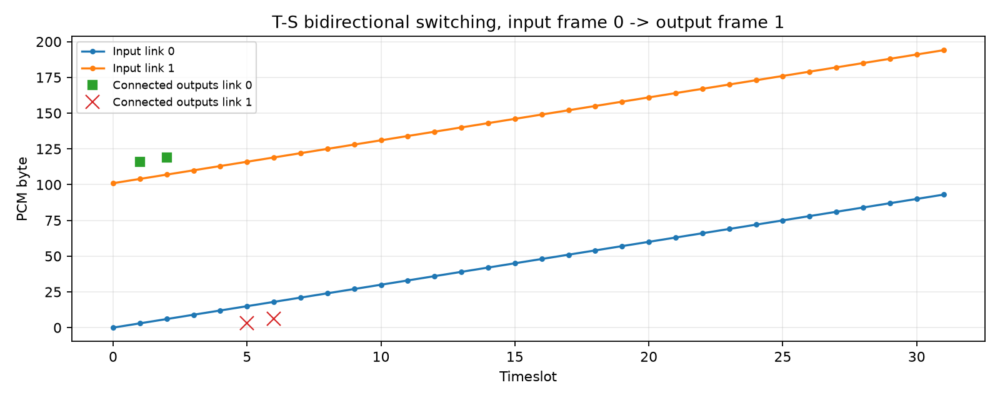

# 实验二报告

姓名：张锋烨
学号：2023352050

## 原理与手算

T接线器按控制表把同一链路的输入时隙搬到另一输出时隙，只改时隙；S接线器在同一时隙上选择输入链路，只改链路。控制表方向统一为输出→输入。

C1 取 A=(0,1)、B=(1,5)：

- A→B：T0\[5]=1，S\[(1,5)]=0

- B→A：T1\[1]=5，S\[(0,1)]=1

输入帧0中 A 的字节为 (0×101+1×3+0×17) mod 256 = 3，B 的字节为 (1×101+5×3) mod 256 = 116。输入帧0完成T→S后结果在输出帧1可用，因此输出帧1的 B 位置应为 3、A 位置应为 116；反方向同时成立。

单T验证：输入 TS1=11、TS3=33，表 {1:3,3:1} 输出 TS1=33、TS3=11。单S验证：TS3 上输出链路0选输入链路1，取的是链路1的 TS3，时隙号不变。

## 结果分析

运行python -m src.run_experiment生成 results/transfer\_check.json、control\_tables.json 和 switch\_mapping.png。4帧×2对连接×2方向共16条记录，mismatches=0，available\_frame\_id 恒等于 input\_frame\_id+1。

control\_tables.json 记录连接前 t\_maps 为 \[{5:1,6:2},{1:5,2:6}]、s\_map 为 {(1,5):0,(1,6):0,(0,1):1,(0,2):1}，pairs 含 C1、C2。请求 (0,1) 与 (1,7) 时因端点占用返回 False，快照与拒绝前一致；释放 C1 后两端输出回 IDLE，C2 仍逐字节正确传送。

## 反例与验证

自拟测试 student\_tests/test\_my\_case.py：

- 输入：先建立 C1=(0,1)-(1,5)，再请求 (0,2)-(0,5)。

- 预期：新端点并未被占用，但两个方向都需要 T0 的输出 TS5，属内部阻塞，必须返回 False，且控制表快照不变。

- 断言：assert connect_pair(...) is False 与 assert snapshot(t)==before。

- 命令与结果：python -m pytest student_tests -q，1 passed。

另外验证重复释放：同一 ID 第二次调用 disconnect\_pair 返回 False 且表不变；释放后原端口可被新连接重用。

## 局限

采用固定先T后S的单路径，不搜索其他内部路径，因此存在内部阻塞；整帧缓存带来固定一帧（125 μs）时延，与真实T接线器的物理延迟并不等价；TS16 保留是本课配置而非所有E1的统一要求；本实验不含信令、呼叫状态机与真实音频，交换数据面后续接入期末程控交换机的呼叫控制。
