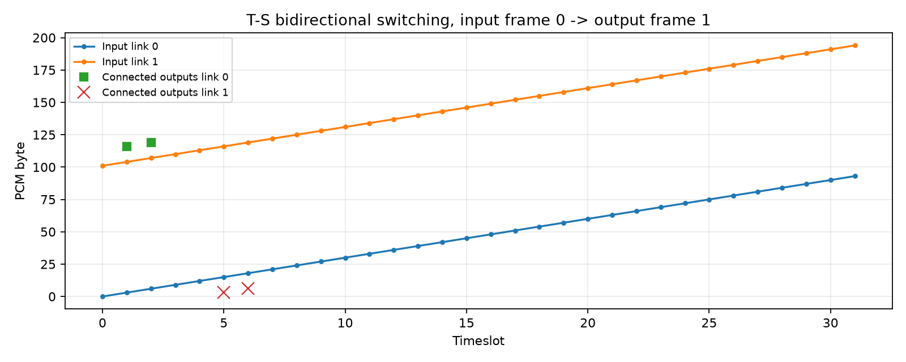

# 实验二报告
姓名：陈梓潮 学号：2024280220 GitHub：alvin11vct11

## 原理与手算
**T 交换改变时隙，S 交换改变链路。** T 接线器把同一输入链路某个时隙的字节写到同一链路的另一个输出时隙，控制表按“输出时隙 → 输入时隙”存放；S 接线器保持时隙号不变，只把某条输出链路的该时隙改从另一条输入链路取字节。本实验固定“先 T 后 S”的单级路径，内部 T 输出冲突同样按阻塞处理，不自动绕路。

**C1 的双向控制表**（A=(0,1)，B=(1,5)）：

| 方向 | T 表项 | S 表项 |
| ---- | ---- | ---- |
| A→B | T0[5] = 1 | S[(1,5)] = 0 |
| B→A | T1[1] = 5 | S[(0,1)] = 1 |

**字节去向手算**：`sample_frame(0)` 的字节为 `(link×101 + slot×3 + frame×17) mod 256`。A 在链路 0 的 TS1，值为 0×101 + 1×3 = **3**；B 在链路 1 的 TS5，值为 1×101 + 5×3 = **116**。经过 T+S 后，输入帧 0 的结果在**输出帧 1** 可用：输出链路 1 的 TS5 应得到 **3**，输出链路 0 的 TS1 应得到 **116**。第二对连接 C=(0,2)、D=(1,6) 同理，写 T0[6]=2、S[(1,6)]=0 与 T1[2]=6、S[(0,2)]=1。

**内部阻塞反例**：C1 已占用 T0[5]。此时请求 (0,2) 与 (0,5)，虽然两个端点都空闲，但前向同样需要 T0 的输出时隙 5，属于内部 T 输出冲突，必须整体拒绝，C1 继续正常传送。

## 结果分析
运行 `python -m src.run_experiment` 生成 `results/transfer_check.json`、`results/control_tables.json` 和 `results/switch_mapping.png`。

**16 次实际传送校验**：4 个输入帧 × 2 对连接 × 2 个方向，共 16 条记录。逐条比对 `expected` 与 `actual`，`mismatches` 为 **0**；每条记录的 `available_frame_id` 都等于 `input_frame_id + 1`，验证了“输入帧 k 的结果在输出帧 k+1 可用”的一帧缓存约定。例如第 0 帧：C1 的 3 从 (0,1) 到达 (1,5)，116 从 (1,5) 回到 (0,1)。

**冲突拒绝**：在 C1、C2 已建立时请求 `connect_pair('conflict', A, (1,7))`，返回 `False`，并且前后两次 `snapshot(tables)` 完全相等，说明检查失败时没有写入任何半成品表项。C2 与 C1 的其余方向不受影响，继续正常转发。

**释放保留**：执行 `disconnect_pair('C1')` 后，C1 的 T、S 表项全部清空；再次建立 C1 可成功，且不干扰 C2 通路。

## 反例与验证
测试场景：尝试建立一对会触发T侧输出时隙冲突的连接。
命令：`python -m pytest grading/test_conflict_internal.py -q`
输入：已有连接占用T0输出时隙5，新建连接同样需要T0输出时隙5
预期：connect_pair 返回 False，交换表不发生任何修改
实际运行：返回False，快照对比无变化，内部阻塞校验生效。

## 局限
本方案为固定路径T-S交换，只做静态查表，一旦T侧输出时隙冲突直接阻塞，**没有自动重路由**；T接线器的一帧缓存是仿真简化模型，真实程控交换芯片存在更精细的读写时序、帧对齐机制；当前只实现通路建立、释放、查表，没有呼叫信令、号码分析、计费、链路状态监控等呼叫控制功能。
